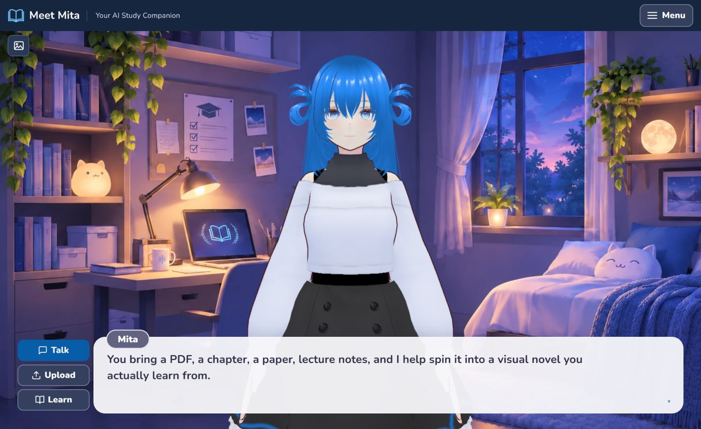
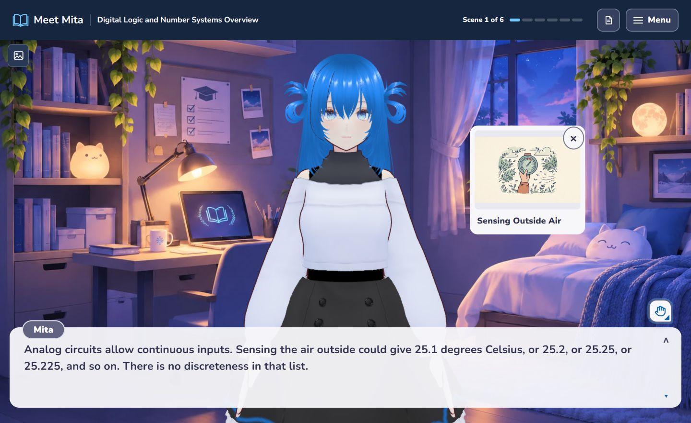
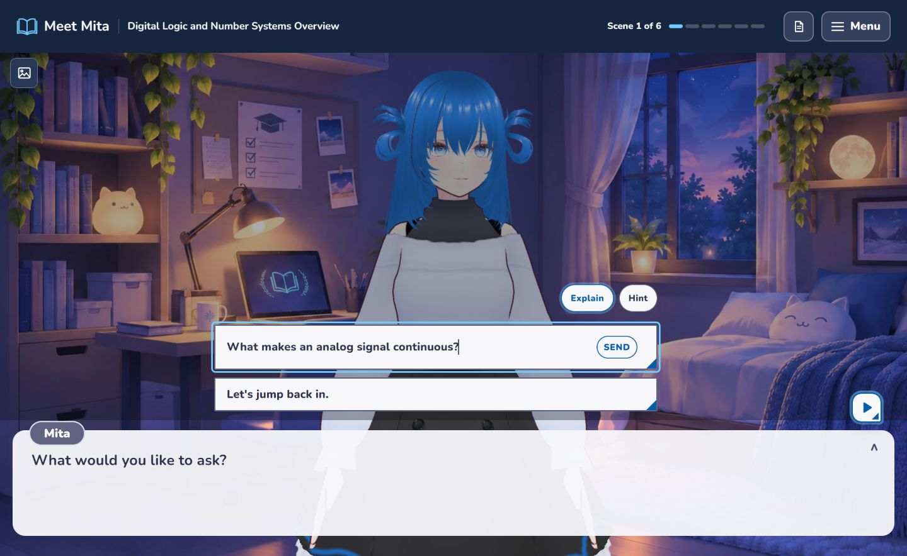

# Meet Mita


Meet Mita is an anime study companion that turns a student's PDF or photos of notes into a playable visual-novel episode. Mita presents the material through dialogue, illustrates selected ideas, pauses for recall questions, and answers questions when the learner raises a hand.

## See the experience

These desktop captures show the current development interface and a saved lesson about digital logic.

**Lobby**



**Episode with a visual aid**



**Raise Hand input**



## From notes to an episode

1. Upload a PDF or up to five ordered photos of pages or notes.
2. Meet Mita analyzes the material, plans a learning roadmap, and creates the first episode.
3. Read the episode with Mita, answer recall checkpoints, and raise your hand to ask about the lesson.

The episode is generated before playback, so each line does not require a new model call. A browser library keeps a local copy of the finished episode; playback and tutoring still require the server. The server also stores its own data. The included sample chapter uses a simulated generation flow and should not be mistaken for a live model run.

## What Meta models do

Meet Mita uses the Meta Model API throughout the experience. The defaults can be configured on the server.

| Model | Contribution |
| --- | --- |
| Muse Spark (`muse-spark-1.3-contributor`) | Reads text from page photos, analyzes source material, plans the roadmap, writes and reviews the episode, and supports grounded in-scene questions. |
| Muse Image (`muse-image-1.0`) | Generates contextual picture cards for selected moments in the episode. Image generation is optional, so a lesson can continue if a picture cannot be created. |

The pipeline combines structured model responses with source retrieval, validation, and token budgets. It creates a bounded lesson from the student's material, with tutoring available inside that lesson. The repository's implementation history begins on October 27, 2026, during the hackathon building period.

## Why this format?

Students often receive material as static documents. Meet Mita tests whether presenting that material through a familiar, character-led format makes a study session more inviting to start and continue.

The intended audience already spends time in digital spaces: the [Philippine Statistics Authority](https://psa.gov.ph/content/percentage-households-internet-connection-increased-488-percent-2024-two-every-three) reports that 98.8% of internet users aged 10 and older used a cellphone to access the internet in 2024. [Dentsu](https://insight.dentsu.com/sportsandentertainment/culture-commerce) reports that half of Gen Z globally watches anime at least weekly. These figures provide audience context; they do not measure Meet Mita's effectiveness. Engagement and learning outcomes remain to be evaluated.

## Run locally

You need Node.js and npm, Python, and a Meta Model API key. From the repository root, in PowerShell:

```powershell
Copy-Item .env.example .env
# Add your META_API_KEY to .env.
python -m venv backend/.venv
backend/.venv/Scripts/python.exe -m pip install -r backend/requirements.txt
npm install
npm run dev
```

Open the local URL printed by Vite. The development server starts the FastAPI backend when the virtual environment is present. Keep the API key in the root `.env`, never in a `VITE_` variable or a commit. Uploaded material is processed by the backend and relevant content is sent to Meta's API. This is a local, single-user proof of concept and is not configured for public hosting.

The interface uses React and TypeScript, with Three.js and VRM for the mascot. A FastAPI backend runs the LangGraph workflow and stores its artifacts. A stand-in appears when the configured mascot cannot run. See [third-party notices](THIRD_PARTY_NOTICES.md) for asset and dependency terms.

## Current scope

Only Episode 1 is generated and playable. Later episodes are roadmap outlines. Generated explanations and images can contain mistakes, so learners should check them against their source material. The project has not established that it improves grades, retention, or engagement.
