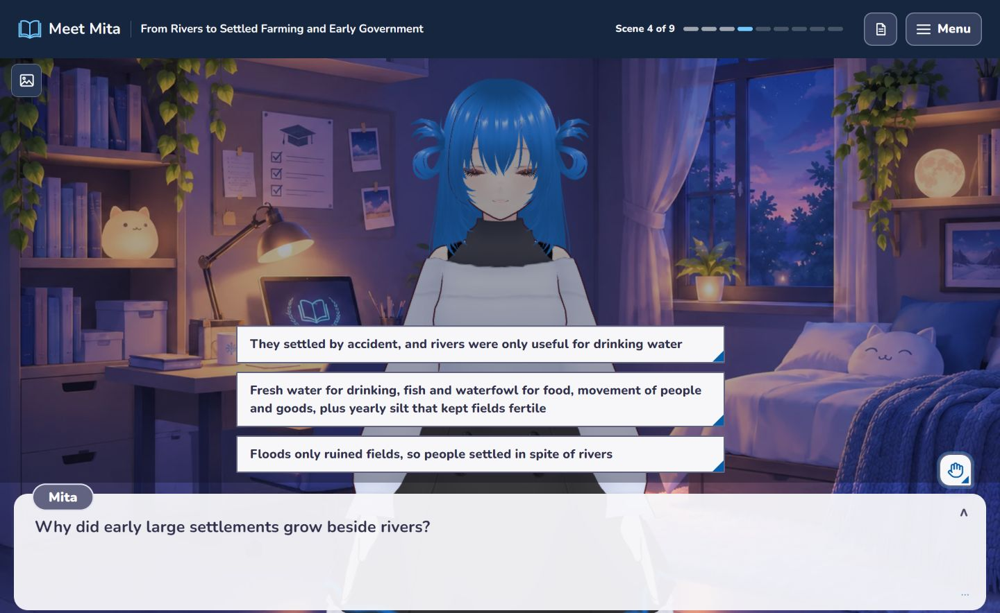

# Meet Mita


Meet Mita turns study material students already have into an anime-style interactive presentation guided by Mita, an expressive 3D learning companion.

Upload a PDF or one to five ordered photos of notes. Meet Mita uses that material to shape a lesson with dialogue, contextual picture cards, recall checkpoints, and questions the learner can ask while the lesson is open. The experience gives a chapter a clear route through its ideas, with Mita guiding the learner along the way.

## Why this format

Students often receive course material as static files. Meet Mita tests a focused design idea: a familiar, character-led presentation may make those materials easier to begin and easier to stay with. Audience research helps shape who the experience is for; the effect on study behavior remains a question for learner testing.

The [Philippine Statistics Authority](https://psa.gov.ph/content/percentage-households-internet-connection-increased-488-percent-2024-two-every-three) reports that 98.8% of Filipino internet users aged 10 and older used a cellphone to access the internet in 2024. [Dentsu](https://insight.dentsu.com/sportsandentertainment/culture-commerce) reports that half of Gen Z worldwide watches anime at least weekly. These figures describe the intended audience's digital and media context; they do not measure Meet Mita's impact.

## How Mita supports a learner

Mita is designed to be a warm, curious guide who explains unfamiliar terms in everyday language before using the formal vocabulary. Her playful side serves the explanation, and she treats a mistake as something to work through. When a correction matters, her guidance stays direct and respectful.

Each lesson begins with a relevant hook, builds the foundations, and moves into application and a recap. Checkpoints ask about ideas already introduced, giving the learner a chance to retrieve and use them. Research by [Karpicke and Roediger](https://doi.org/10.1126/science.1152408) found benefits from retrieval practice in a vocabulary learning experiment. Meet Mita's multiple-choice checkpoints draw on that principle; the study does not measure this app's results.

When a learner chooses an incorrect answer, Mita's feedback is written for that choice. It identifies the mix-up and offers a next step without revealing the correct option, leaving the learner room to reason and try again. A correct answer comes with an explanation of why it fits.

Raise Hand lets the learner pause at a specific point, ask for an explanation or hint, and return to the lesson. Tutor responses can show supporting document references or indicate when an answer goes beyond the source. The learner can challenge an answer and examine the evidence behind it. Relevant picture cards put a visual beside an explanation; [Mayer's research on multimedia learning](https://eric.ed.gov/?id=EJ456638) examines how words and pictures can support understanding. These are design choices to investigate with learners, rather than measured gains for Meet Mita.

The player also supports keyboard and touch interaction, with a reduced-motion setting, so learners have more than one way to move through the experience.

## From study material to a guided lesson

Meet Mita brings Meta models into a familiar learning task: understanding material a student has been assigned or saved. The uploaded source shapes the lesson. Muse Spark analyzes and organizes its ideas, develops the first episode, checks the generated lesson, and answers questions in context. Muse Image creates picture cards tied to the material being discussed. During playback, the learner can pause to recall an idea or raise a hand for an explanation or hint grounded in the source.

```mermaid
flowchart LR
  A[PDF or ordered page photos] --> B[Extract and index source material]
  B --> C[Muse Spark surveys concepts]
  C --> D[Muse Spark plans the roadmap]
  D --> E[Muse Spark develops Episode 1 context]
  E --> F[Muse Spark generates and validates the lesson]
  F --> G[Muse Image creates contextual picture cards]
  G --> H[Guided lesson with recall and in-scene questions]
```



The project fits the event's Build for Your World track by bringing Meta's models to a familiar study task: turning a student's own course material into a guided lesson. The models contribute across a multi-stage workflow, with distinct roles in planning, generation, review, visual explanation, and tutoring.

The submitted implementation was built during the hackathon. Repository history begins on October 27, 2026.

## See the experience

These desktop captures show the development interface and saved lessons. The recall checkpoint capture uses an earlier interface and a history lesson.

**Lobby**


**Episode with a visual aid**


**Recall checkpoint**



**Raise Hand input**


## How Meta models shape the lesson

### Muse Spark: from source to tutor

Meet Mita uses `muse-spark-1.3-contributor` through Meta's Model API for the text workflow. The backend extracts and indexes the uploaded material, then Muse Spark surveys its concepts and helps plan the lesson. It develops context for the first-episode scope, generates the lesson dialogue and checkpoints, and reviews the draft before the app publishes it. During the lesson, Muse Spark also responds to questions using retrieved passages from the same source.

The generation flow combines model output with application steps for source retrieval, structured responses, validation, and token budgets. The lesson is prepared before playback, so each line of dialogue does not trigger a separate model request.

### Muse Image: concepts made visible

Meet Mita uses `muse-image-1.0` to create picture cards for selected concepts in the lesson. The cards appear beside the relevant dialogue so a learner can see a visual explanation while Mita discusses the idea. This gives Muse Image a specific role in the learning experience, alongside Muse Spark's planning and tutoring work.

## Current scope and future potential

The current proof of concept generates one playable first episode from a source. Later episodes appear as roadmap outlines. This gives the project a clear next direction: make more of the roadmap playable, then study whether learners choose to start, finish, and return to these sessions. Those are future questions to measure, not results claimed by the current build.

Meet Mita runs locally for one learner at a time. Uploaded material is processed by the backend, and relevant content is sent to the configured Meta API. The browser keeps a local copy of a finished lesson, but playback and tutoring still require the server. The included sample chapter simulates the generation steps in the interface and uses an existing ready lesson when one is available; it does not create a new episode from a fresh upload.

## Run locally

You need Node.js and npm, Python, and a Meta Model API key. From the repository root, in PowerShell:

```powershell
Copy-Item .env.example .env
# Add your META_API_KEY to .env.
python -m venv backend/.venv
backend/.venv/Scripts/python.exe -m pip install -r backend/requirements.txt
npm install
npm run dev
```

Open the local URL printed by Vite. When the virtual environment is present, the development server starts the FastAPI backend. Keep the API key in the root `.env` file, never in a `VITE_` variable or a commit.

## Implementation

React, TypeScript, and Vite provide the interface. FastAPI runs the backend, and LangGraph coordinates the document-to-lesson workflow. Three.js and VRM render Mita, with a stand-in when the configured mascot cannot load. SQLite stores application records, while Chroma supports retrieval from uploaded material.
