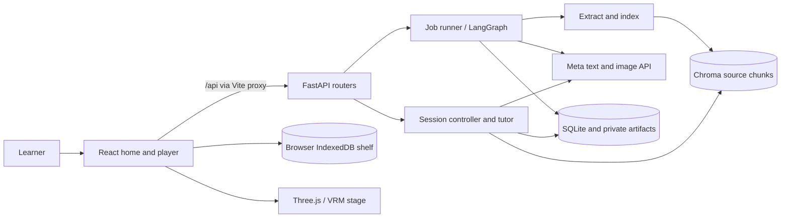

# Project context for coding agents

Snapshot: 2026-11-04. This guide describes the checked-in implementation of Meet Mita. Source code and the latest verification records remain authoritative when they differ from this snapshot. Start with [AGENTS.md](../AGENTS.md) for the session workflow, [agent-progress.md](../agent-progress.md) for recent evidence and unresolved issues, and [feature_list.json](../feature_list.json) for feature status. The [glossary](../GLOSSARY.md) defines job and document terminology. The [product specification](../visual_novel_spec_v1_1.md) includes aspirations; it is not evidence that a feature is implemented.

## Product and boundaries

Meet Mita is a local, single-user educational visual novel. A learner provides a PDF or ordered photos of notes; the backend extracts and indexes the material, creates a curriculum roadmap, generates and validates a lesson, and serves a playable episode. Mita presents dialogue, recall questions, and generated picture cards. During the episode the learner can pause and ask a grounded question. The system generates **only Episode 1**; other episodes are roadmap outlines, not playable generated lessons.

The repository name is JustMaya, while the product and UI use **Meet Mita**. It is a proof of concept, not a multi-user hosted service. Source material and relevant retrieved content may be sent to the configured Meta API. See [README](../README.md) for the public overview and setup.

## Learner guide

1. Start the app using the setup below and open Vite's local URL. The home screen has Talk, Upload, Learn, and Menu controls. Home Talk uses local scripted intent routing; it is separate from the model-backed lesson tutor.
2. Select Upload and choose a PDF or photos. Defaults allow a PDF up to 20 MiB and 100 pages, or 1–5 photos up to 10 MiB each and 20 MiB combined. Photos are processed in the selected order. Validation and actual configurable limits live in [config.py](../backend/app/config.py) and [documents.py](../backend/app/api/documents.py).
3. Home starts and polls the job. It automatically confirms the generated roadmap and resumes processing. It presents progress and, when ready, offers the episode. The developer review page instead exposes roadmap review and editing.
4. Open a lesson from the offer or Learn. The server creates a learner session. Advance the dialogue, answer recall checkpoints, inspect picture notes and the backlog, or use Raise Hand for an explanation or hint. Resume returns to the saved reading position; rewind navigates to an earlier supported position.
5. Learn also displays roadmap outlines. A browser shelf retains a local copy of completed material in IndexedDB; deleting that copy does not delete server data. Playback and tutoring still depend on the server. Background and motion choices are browser preferences; full motion is the default, with reduced motion and device setting available in Menu.

The sample button simulates generation in the browser. It attempts to find an existing ready server episode, preferring a document named `sample-chapter.pdf` and otherwise using the first ready document. It does not itself upload the sample or create a new episode; playback needs an existing server episode.

## Running and verification

Prerequisites: Node.js/npm, Python, and a Meta API key. From the root in PowerShell:

```powershell
Copy-Item .env.example .env
# Put META_API_KEY in the root .env; never commit it or expose it as VITE_*.
python -m venv backend/.venv
backend/.venv/Scripts/python.exe -m pip install -r backend/requirements.txt
npm install
npm run dev
```

Vite starts Uvicorn using `backend/.venv` when available and proxies `/api` to `127.0.0.1:8000`. The backend reads the **root** `.env`; `GET /health` is a backend health check, not a Vite-proxied `/api` route. If needed, start the backend separately from `backend/` with `.\.venv\Scripts\python.exe -m uvicorn app.main:app`; avoid starting a second instance on the same port. Vite warns and continues without the backend if the virtual environment is absent. The app requires `META_API_KEY` during backend configuration.

```powershell
.\init.ps1                  # npm install, lint, build; does not create Python venv
npm run lint
npm run build
cd backend
.\.venv\Scripts\python.exe -m pytest app/tests
```

`init.sh` provides the Unix bootstrap. Backend tests include optional live checks; consult their markers and environment requirements before running paid external calls. Browser probes live in [scripts](../scripts/) and have their own runtime prerequisites. The last release record notes an existing large VRM bundle warning and unresolved physical-device/compositor acceptance; do not infer a fresh pass from historical evidence. Record actual commands and results for new work.

## System map



| Area | Technology and responsibility | Entry points |
| --- | --- | --- |
| Frontend | React 19, TypeScript, Vite; Tailwind plugin and CSS; browser IndexedDB and localStorage | [main.tsx](../src/main.tsx), [App.tsx](../src/App.tsx), [learnerApi.ts](../src/learnerApi.ts) |
| Home | Upload, job polling and automatic roadmap confirmation, shelf, scripted lobby dialogue | [Home.tsx](../src/home/Home.tsx), [dialogueEngine.ts](../src/home/dialogueEngine.ts), [browserShelf.ts](../src/home/browserShelf.ts) |
| Player | Server-authoritative session rendering, dialogue, checkpoints, Raise Hand, backlog and picture notes | [VisualNovelPlayer.tsx](../src/player/VisualNovelPlayer.tsx), [player components](../src/player/) |
| Mascot | Three.js, `@pixiv/three-vrm`, optional Mixamo animation; lazy renderer and fallback | [MascotStage.tsx](../src/player/MascotStage.tsx), [VRMCanvas.tsx](../src/player/VRMCanvas.tsx), [mascotModels.ts](../src/player/mascotModels.ts) |
| HTTP | FastAPI, Pydantic settings and models | [main.py](../backend/app/main.py), [api](../backend/app/api/), [models](../backend/app/models/) |
| Generation | LangGraph stages and SQLite checkpointing, PyMuPDF, Pillow, Chroma and Meta provider | [pipeline](../backend/app/pipeline/), [services](../backend/app/services/) |
| Persistence | SQLite application database, private files and artifacts, separate LangGraph checkpoint database and Chroma store | [storage](../backend/app/storage/), [database.py](../backend/app/storage/database.py) |

Dependency versions and scripts are maintained in [package.json](../package.json) and [requirements.txt](../backend/requirements.txt). The frontend navigates between home and player in `App.tsx`; `?session=<id>` restores a server session on reload. `/dev/review` is a separate developer inspection surface, documented in [curriculum-api.md](../backend/curriculum-api.md).

## Document-to-episode flow

1. `POST /api/documents` accepts multipart `file`; `POST /api/documents/photos` accepts repeated multipart `files`. Upload creates document and queued job records. PDF validation rejects invalid, encrypted, empty, oversized, or over-page-limit input. Same-hash PDFs can share stored bytes, while receiving separate document/job records. Photos are normalized before private storage.
2. Home calls `POST /api/jobs/{job_id}/run` and polls `GET /api/jobs/{job_id}`. A standalone `python -m app.pipeline.worker` can also drain queued work and recover abandoned jobs. Both use the runner and atomic claims; `can_run` is computed on the server. Do not infer run eligibility from the display status alone.
3. The actual [stage sequence](../backend/app/pipeline/nodes.py) is `extract → index → analyze → plan → detail → generate → validate`. Extract handles PDF text or photo extraction. Index creates retrievable chunks. Analyze surveys concepts, then plan saves a roadmap. Until confirmation, detail/generate/validate park and the job reaches `awaiting_review`.
4. Confirmation freezes the selected Episode 1 scope and releases the job for resumption. Detail analysis builds lesson context for that scope, then generation uses retrieved source passages. Validation checks and reviews the draft before publication. `ready` means an episode was published, not merely that the graph reached its end.
5. LangGraph checkpoints are keyed by job ID. Runner admission and resume logic protect partial work; transient stage errors have bounded retries. A model failure, budget failure, or failed validation can leave a failed job with an actionable error rather than a ready lesson. See [runner.py](../backend/app/pipeline/runner.py), [jobs.py](../backend/app/storage/jobs.py), and [GLOSSARY.md](../GLOSSARY.md).

The frontend's automatic confirmation is a product behavior, not a property of the API. The review API supports reading, revision-checked editing and confirmation before resumption. See [curriculum-api.md](../backend/curriculum-api.md) for request contracts. The detailed analysis and generation remain limited to the confirmed first-episode scope.

## Session and tutoring flow

A ready episode is fetched through `GET /api/episodes/{episode_id}`; `POST /api/episodes/{episode_id}/sessions` creates a session. The player reads session state and applies advance, answer, raise-hand, question, resume and rewind operations through [learnerApi.ts](../src/learnerApi.ts). The server owns scene position, mode, checkpoint attempts and version in [session_controller.py](../backend/app/services/session_controller.py) and [sessions.py](../backend/app/storage/sessions.py). Learner-facing episode and checkpoint projections withhold answer keys until appropriate; preserve this boundary when changing models or APIs.

Mutating session requests carry a unique `request_id` and current `expected_version`. The server records requests for idempotency and uses versions to reject conflicting updates. On conflict, fetch the current session and let the UI reconcile; do not silently overwrite it. A question is prepared and checked, the model runs outside the write transaction, and the result is committed with the version and request safeguards. Follow-up tutoring keeps server-owned thread and help-mode metadata. Retrieval is filtered by document ID; references and grounding status can accompany a tutor response. Model/provider and token-budget errors are surfaced as structured errors.

Illustrative frontend call using the actual client interface:

```ts
import { api } from './learnerApi'

const session = await api.createSession(episodeId)
const advanced = await api.advance(session.sessionId, {
  request_id: crypto.randomUUID(),
  expected_version: session.version,
})
// Use advanced.version for the next new mutation.
```

A question requires a session in a valid mode (normally enter Raise Hand first):

```ts
const paused = await api.raiseHand(advanced.sessionId, {
  request_id: crypto.randomUUID(), expected_version: advanced.version,
})
const result = await api.askQuestion(paused.sessionId, {
  request_id: crypto.randomUUID(), expected_version: paused.version,
  question: 'Why does this step work?', help_mode: 'explain',
})
// result.interaction contains the answer; result.session is the new state.
```

These snippets illustrate the contract, not a complete UI or retry implementation. Reuse the same request ID when retrying the same logical operation; generate a new ID for a new action. See [session models](../backend/app/models/session.py) and [tutor_flow.py](../backend/app/services/tutor_flow.py) for exact constraints and transitions.

## API reference map

| Endpoint | Purpose |
| --- | --- |
| `GET /health` | Backend liveness |
| `POST /api/documents`, `POST /api/documents/photos` | Submit PDF or ordered photos and enqueue work |
| `GET /api/documents` | List documents with a ready episode |
| `GET /api/jobs/{id}`, `POST /api/jobs/{id}/run` | Inspect or synchronously request a run/resume |
| `GET`, `PUT /api/documents/{id}/curriculum`; `POST .../curriculum/confirm` | Inspect, edit with revision, and confirm roadmap |
| `GET /api/documents/{id}/inspection/{stage}` | Local developer inspection of extraction, index or analysis |
| `GET /api/episodes/{id}`, `GET /api/episodes/{id}/pictures/{name}` | Learner episode projection and picture assets |
| `POST /api/episodes/{id}/sessions`, `GET /api/sessions/{id}` | Create and read a session |
| `POST /api/sessions/{id}/{advance,answers,raise-hand,questions,resume,rewind}` | Session transitions and tutoring |

See the router and Pydantic models for wire formats and status codes. Errors generally use `{"error":{"code":"...","message":"...","retryable":false}}`; request validation returns 422, conflicts can return 409, and provider/budget errors can return 503. The inspection routes expose source content and are intended for the local development environment.

## Models, retrieval, and limits

[model_provider.py](../backend/app/services/model_provider.py) isolates Meta's OpenAI-compatible API, structured responses, retries and provider errors. Defaults are `muse-spark-1.3-contributor` for text and `muse-image-1.0` for images; see [config.py](../backend/app/config.py) for authoritative defaults and environment overrides. API keys stay on the server. [token_budget.py](../backend/app/services/token_budget.py) records usage and enforces configured stage/job budgets. A default is a configuration value, not a guarantee of total monetary cost.

[rag_indexer.py](../backend/app/services/rag_indexer.py) and [vector_store.py](../backend/app/services/vector_store.py) build the Chroma index; [retriever.py](../backend/app/services/retriever.py) returns document-scoped passages and source metadata. Similarity is a ranking signal, not proof of correctness. [picture_cards.py](../backend/app/services/picture_cards.py) handles generated lesson visuals. Provider calls, image generation and photo extraction can incur external usage; tests with mocks do not prove live availability.

## Persistence and configuration

The default `backend/data/` holds `app.db`, private uploads and artifacts, `checkpoints.db`, and the Chroma directory. SQLite tables include documents, jobs, roadmaps, episodes, token usage, learner sessions and session request IDs. The app initializes schema and storage at startup; [database.py](../backend/app/storage/database.py) owns its migrations and schema. Private storage is not mounted as a public static directory; picture assets are exposed through a controlled endpoint. Keep real uploads, generated data, `.env`, and credentials out of commits.

The browser shelf is separate from server persistence. Clearing IndexedDB or removing a shelf item does not remove the server document, and an IndexedDB episode copy is not an offline session backend. The frontend also stores background and motion choices in localStorage. The default VRM model is selected in [mascotModels.ts](../src/player/mascotModels.ts); `VITE_MASCOT_MODEL`, `VITE_MASCOT_VRM_URL`, and `VITE_MASCOT_IDLE_URL` configure public asset selection. The stage falls back to a placeholder if rendering or model loading cannot proceed.

## Working safely in this repository

- Follow the startup and one-feature harness in [AGENTS.md](../AGENTS.md); consult [pipeline-b-session-contract.md](pipeline-b-session-contract.md) when its stated feature boundary applies. `feature_list.json` and `agent-progress.md` are evidence and handoff records, not a substitute for inspecting current code.
- Reuse shared `vn-*` player chrome and `MotionToggle` per the UI contract in AGENTS.md. Preserve learner projections, session version/idempotency semantics, and the single-episode scope when changing behavior.
- For code navigation, use CodeGraph first when `.codegraph/` exists. For dependency and impact questions use the local graphify graph when available; verify graph findings against current source, since generated graphs can lag.
- The current backend is local and single-user. Inspection endpoints and private data handling are not a multi-tenant authorization scheme. Treat a deployment or security redesign as separate work.
- Update this guide when observable behavior, entry points, or boundaries change. Prefer links to living configuration, contracts and tests over duplicating exhaustive values here.
